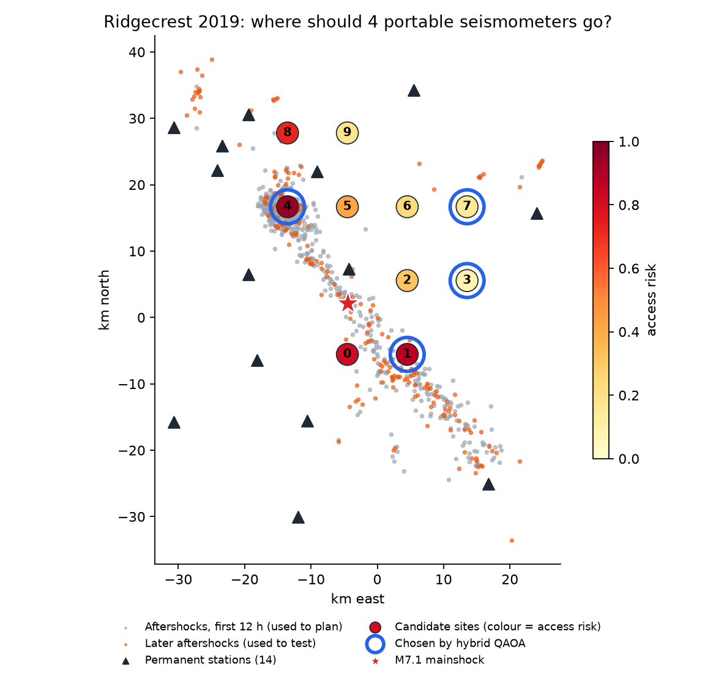
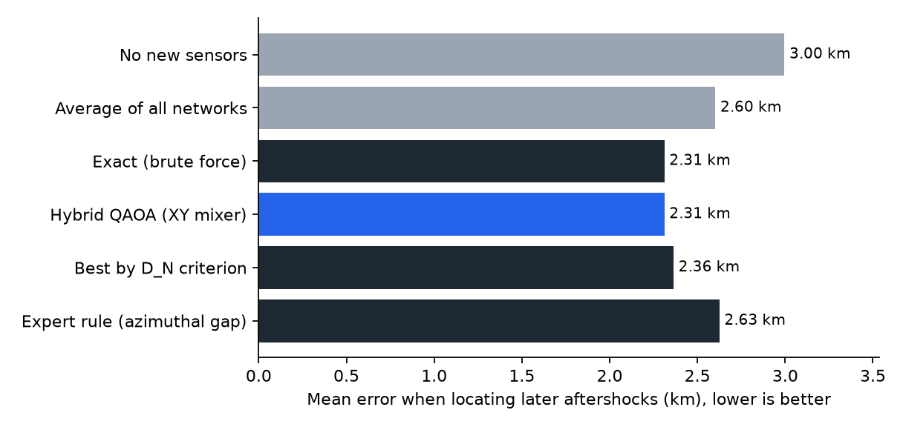
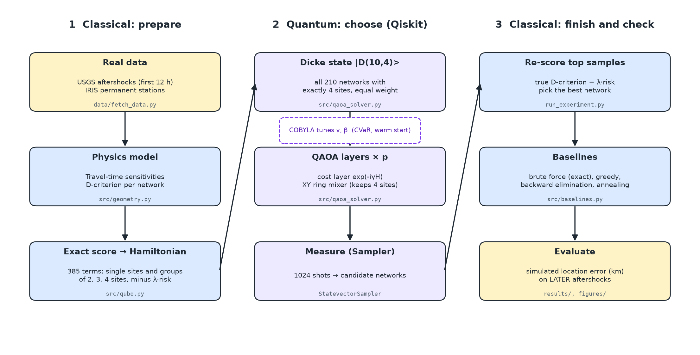

# QuakeNet-Q

**Hybrid quantum–classical placement of portable seismometers after a major earthquake.**
Qiskit Fall Fest 2026 Hackathon · Domain: **Disaster Response**

After a big earthquake, response teams rush a few portable seismometers into the field. Where they
put them decides how sharply the aftershocks can be located, and published deployment reports
describe that choice as expert judgement under time pressure. QuakeNet-Q treats it as an
optimisation problem: **choose 4 of 10 candidate sites** to make aftershock locations as sharp as
possible while avoiding redundant sensors and sites that are risky for crews to reach. A
constraint-preserving QAOA circuit in Qiskit makes the choice, and everything is checked against
exhaustive search on **real data from the 2019 Ridgecrest (California) M7.1 earthquake**.



## Results at a glance

All numbers come from `python run_experiment.py` (`results/results.json`).

| Question | Answer |
|---|---|
| Does the placement help? | In a simulated location test on **217 later aftershocks** the planner never saw, the mean location error falls from **3.00 km** (no new sensors) to **2.31 km** with the chosen sites. A field rule that closes the largest azimuthal gap gives 2.63 km; the average of all 210 networks gives 2.60 km. Our pick ranks 4th of 210 in that test. |
| Is the quantum answer correct? | Yes. In 15 of 15 runs the hybrid QAOA returned sites **{1, 3, 4, 7}**, the exact optimum found by brute force over all 210 networks. |
| Does the quantum circuit do real work? | It raises the chance that one measurement gives the best network from 0.48% (random valid network) to **5.1%** with 1 layer, **8.3%** with 2 and **11.0%** with 3. Our target was 20%; we did not reach it. |
| Is the circuit's score the real score? | Yes. The circuit encodes the exact D-optimality score (385 terms with up to 4-site interactions), with zero error on all 210 networks. The usual pairwise approximation ranks well (ρ = 0.987) but picks only the 2nd-best network at risk weight λ = 300. |
| Does it beat classical methods? | **No.** Greedy, backward elimination and simulated annealing also find the optimum, and brute force takes milliseconds at this size. We claim no quantum speedup. |



## The problem

- **Users:** rapid-response seismology teams (e.g. USGS, INGV, GFZ) and the emergency managers who use their aftershock maps.
- **Limited resource:** 4 portable instruments.
- **Competing objectives:** location accuracy vs. sensor redundancy vs. access risk for field crews. The most informative sites sit on the active rupture, which is also the hardest place to work.

### Formulation

| Item | Definition |
|---|---|
| Variables | `x_i ∈ {0,1}`, 1 if a sensor goes to candidate site `i` (10 sites → 10 qubits) |
| Constraint | `Σ x_i = 4` (enforced by the circuit, not by a penalty) |
| True score | `D(S) = Σ_events log det F_e(S)`, the D-optimality criterion: `F_e` is the Fisher information of an aftershock's location (x, y, depth, origin time) given the permanent stations plus the chosen sites |
| Circuit objective | `f(x) = Σ_{|T|≤4} w_T Π_{i∈T} x_i − λ Σ_i c_i x_i`: the inclusion–exclusion (Möbius) expansion of `D`, exact on every 4-site network. `w_{i}` = information from site `i` alone, `w_{ij}` = pair interaction (negative when two sites are redundant), and so on up to groups of 4; `c_i` = access risk, λ = 150 |
| Test instance | 550 M≥3 aftershocks from the first 12 h (planning), 217 later aftershocks (testing), 14 permanent stations, 10 candidate sites, 210 allowed networks |

The log-determinant is not quadratic. Because the circuit only holds 4-site networks, terms up to
4 sites reproduce it exactly: 385 terms, which become Z, ZZ, ZZZ and ZZZZ terms in the Hamiltonian
(about 3,000 gates per layer, against about 900 for the pairwise version). We chose exactness and
measured the cost.

### Why this quantum algorithm

QAOA is the standard near-term algorithm for this kind of yes/no selection problem. The usual way to handle "exactly 4
sites" is a penalty term, which wastes probability on invalid answers and needs a hand-tuned
weight. We instead start in a **Dicke state** (an equal mix of all 210 valid networks) and use an
**XY ring mixer**, which only swaps a chosen site with an unchosen one. The circuit can never leave
the valid networks. Our penalty-based ablation confirms the difference: it produces a valid
4-site answer only 52–73% of the time and finds the optimum less often than random guessing
(with one untuned penalty weight, so a tuned penalty could do better).



## The agent

"Agent" here means an automated program, not AI. It runs on the team laptop behind the web API and
does what a response team would otherwise do by hand:

1. **Trigger.** It reads the USGS live feed (updated every minute). An earthquake at or above the
   trigger magnitude, with a permanent station within range, starts a run. The trigger magnitude
   and every other setting can be changed on the Settings page (for example 4.0 instead of 6.5).
   Live mode is off by default; any listed earthquake can also be started by hand.
2. **First plan within minutes.** If too few real aftershocks exist yet, it simulates them along the
   expected rupture (rupture length from Wells & Coppersmith 1994, magnitudes from a
   Gutenberg-Richter law) and plans on those.
3. **Hourly checks.** It compares the plan with the aftershocks recorded since. If the activity has
   moved more than 5 km or the plan's score fell by more than 20%, it re-plans, with a cost for each
   sensor that has to be moved.
4. **Memory.** It keeps the circuit angles that worked (the next run starts from them), how well its
   past plans predicted their own score (which sets a confidence level), and weights for three
   wave-speed models.

Every plan uses the quantum circuit, trained with CVaR (the average of the best 10% of outcomes),
and is checked against an exact search; if they disagree after two retries, the exact answer is
published and flagged. Past earthquakes can be replayed hour by hour on the Monitor page; a 24-hour
Ridgecrest replay takes about 20 seconds.

## Other earthquakes

`python run_benchmarks.py` repeats the test on five earthquakes (South Napa 2014 was skipped: only 9
later aftershocks to test on). Full tables: `research/benchmarks/2026-11-12_benchmark_results.md`.

| Earthquake | Best network per measurement, mean / CVaR training | Our optimum against the expert rule |
|---|---|---|
| Ridgecrest 2019 | 3.8% / 9.6% | 2.4% lower location error |
| Monte Cristo Range 2020 | 1.2% / 7.3% | 0.1% higher |
| Anchorage 2018 | 0.4% / 1.6% | 0.7% higher |
| Ferndale 2022 | 6.0% / 7.0% | 2.9% higher |
| Puerto Rico 2020 | 6.2% / 8.2% | 15.8% higher |

CVaR training made the final pick exact in 14 of 15 runs, against 8 of 15 with the usual training.
**The optimised network beat the field rule on only one of five earthquakes** in the simulated
location test: the D-optimality score does not always predict location error. We report that as it
is; finding a score that does is the most useful next step.

## Run it

Requires Python 3.10+.

```bash
pip install -r requirements.txt
python -m pytest tests -q          # 303 checks, about 45 s
python run_experiment.py --quick   # 1 seed, p = 1: under a minute
python run_experiment.py           # full run: about 45 minutes
python run_benchmarks.py           # five more earthquakes: about 11 minutes
python run_extras.py               # noise study and 24-hour agent replay: about 1 minute
python report/make_diagram.py      # report diagrams
python report/build_report.py      # the .docx report (and a PDF copy if Word is installed)
```

Outputs: `results/results.json` and the figures in `figures/` (the quick run writes
`results/results_quick.json` and `figures_quick/` so it never overwrites the full results). The data is cached in `data/`, so
no internet is needed. `python data/fetch_data.py` re-downloads it from USGS and IRIS.

## Repository layout

| Path | Purpose |
|---|---|
| `data/fetch_data.py`, `data/*.json` | Download and cache of USGS aftershocks and IRIS station locations |
| `src/geometry.py` | Instance, travel-time physics, D-criterion, blur metric |
| `src/qubo.py` | Exact objective (terms up to 4 sites), pairwise QUBO, Hamiltonian |
| `src/location.py` | Independent simulated location test |
| `src/sources.py`, `src/candidates.py` | Outbound data gateway; candidate sites from roads and terrain |
| `src/qaoa_solver.py` | Dicke state, XY mixer, QAOA circuits, COBYLA loop, sampling |
| `src/baselines.py` | Brute force, greedy, backward elimination, simulated annealing, expert rule, random |
| `src/instances.py`, `src/noise.py` | Any earthquake as an instance; simulated gate-noise study |
| `src/agent/` | The agent: settings, planner, hourly sequence, feed watcher, memory |
| `api/` | FastAPI backend (runs on the team laptop) |
| `web/` | Next.js test console, deployed on Vercel |
| `docs/` | Architecture, API contract, decisions, design spec |
| `run_experiment.py` | End-to-end experiment and figures |
| `tests/` | Checks of the formulation and the circuit |
| `report/` | Report (.docx), its build script and the diagram script |
| `research/` | Notes on every source we consulted |
| `VIDEO_SCRIPT.md` | 3-minute pitch script |

## Limitations

- **No quantum advantage.** 210 networks can be enumerated instantly and simple classical heuristics find the optimum.
- **The exact objective does not scale.** It needs 385 terms for 4 of 10 sites, and the count grows fast with more sensors.
- **Below our success target.** The best network comes up in 2–11% of measurements, not the 20% we aimed for.
- **The score does not always beat a field rule.** On four of five benchmark earthquakes the expert rule's network located aftershocks as well or better in simulation.
- **Hearing range uses assumed constants** (noise level, attenuation law), and the noise study is a classical simulation of gate errors, not a hardware run.
- **Live mode** has only been tested with a recorded feed, not during a real qualifying earthquake.
- **The location test is simulated** with the same simple physics (different wave speed, added noise), not real recordings.
- **Simplified physics:** uniform 6 km/s velocity, P arrivals only, 0.1 s picking error, flat earth.
- **Synthetic parts:** candidate sites come from a grid rule and access risk from a distance-to-rupture rule (`exp(−d / 5 km)`). Real deployments would use road, permit and safety data.
- **Noise-free simulation only.** The XY circuit is deep (depth about 2,300 to 6,300 for 1 to 3 layers, against 54–118 for the penalty circuit), so it would suffer on today's hardware.
- **The "siting is manual" claim** rests on published deployment reports, not interviews with practitioners, and "no prior quantum work" means our searches found none.

## Credits

Code in this repository was written for this hackathon, with AI assistance (Claude Code). Ideas we build on:

- Rabinowitz & Steinberg (1990), *BSSA* 80(1), 187–196: D-optimal seismic network design.
- Hardt & Scherbaum (1994), *Geophys. J. Int.* 117(3), 716–726: optimum aftershock networks by simulated annealing.
- Toledo, Jousset, Maurer & Krawczyk (2020), *J. Volcanol. Geotherm. Res.* 391, 106433: D-criterion with sequential station elimination.
- Cochran et al. (2020), *Seismol. Res. Lett.* 91, 1952–1960: the USGS rapid deployment at Ridgecrest.
- Hadfield et al. (2019), *Algorithms* 12(2), 34: Quantum Alternating Operator Ansatz (XY mixers).
- Bärtschi & Eidenbenz (2019), *FCT 2019*: deterministic Dicke-state preparation (implemented in `dicke_state` from the paper's description).
- San Martín et al., arXiv:2305.08738: QAOA sensor placement on civil structures with XY mixer and Dicke state.
- Farhi, Goldstone & Gutmann (2014), arXiv:1411.4028: QAOA.

Data: U.S. Geological Survey ComCat earthquake catalogue (public domain); station metadata from the
EarthScope/IRIS FDSN service, Southern California Seismic Network (CI).
